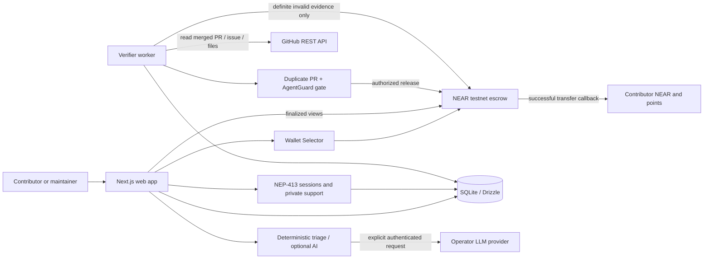
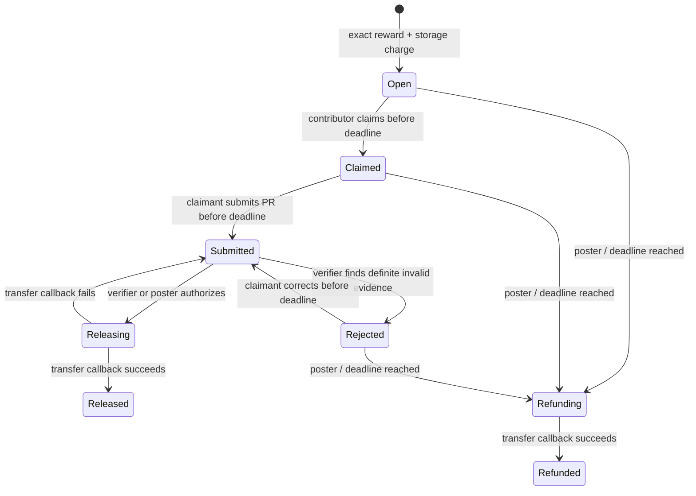

# GitSettle system guide

GitSettle pays native NEAR for GitHub contributions. The repository is a small npm workspace plus an independent Rust contract. The contract owns escrow and reputation. SQLite stores descriptive metadata, verification results, leaderboard snapshots, wallet sessions, support conversations and AI quotas; it cannot authorize a payment.



## Where to work

| Path | Responsibility |
| --- | --- |
| `contracts/gitsettle/src/lib.rs` | Native escrow, authorization, deadlines, storage charge, payout callbacks, views |
| `contracts/gitsettle/src/tests.rs` | State/access tests, transfer failure recovery, storage bounds |
| `packages/shared/src/types.ts` | JSON shapes shared by worker, API, and UI |
| `packages/shared/src/near.ts` | Read-only finalized contract views and runtime public config |
| `packages/shared/src/db.ts` | Additive SQLite schema, durable metadata/audit, real rank snapshots |
| `packages/shared/src/data.ts` | Explicit demo dataset and live read-model assembly |
| `packages/shared/src/transactions.ts` | Wallet-return transaction verification, without signing |
| `services/verifier/src/github.ts` | GitHub evidence policy, pagination, timeouts, rate limits |
| `packages/shared/src/dedupe.ts` | Canonical issue/PR identities and active duplicate matching |
| `packages/community/src` | NEP-413 authentication, hashed sessions, ticket ACLs and spam limits |
| `packages/triage/src` | Advisory issue checks, bounded provider API and persistent wallet quotas |
| `services/verifier/src/agentguard.ts` | Pinned local risk rules and exact per-release amount cap |
| `vendor/agentguard` | Unmodified MIT upstream rules/types, license and hash manifest |
| `services/verifier/src/near.ts` | Dedicated testnet signer adapter |
| `services/verifier/src/worker.ts` | Serial verification loop and final-state reconciliation |
| `apps/web/src/app/api` | Public chain APIs, wallet receipt checks, authenticated community/AI routes |
| `apps/cli` | Executable terminal client; finalized reads, exact transaction previews and explicit signing |
| `packages/shared/src/read-cache.ts` | Short-lived display cache with in-flight coalescing and explicit invalidation |
| `packages/shared/src/metadata.ts` | Bounded background refresh for public GitHub descriptions |
| `apps/web/src/components` | Interactive screens, wallet context, display states |
| `scripts` | Local wallet provisioning, atomic deployment, seeds, live-loop evidence |
| `docs/CONTRACT_API.md` | Canonical method signatures, limits, currency/time units |
| `docs/DESIGN.md` | Visual tokens, page layouts and state matrix |
| `STATUS.md` | Actual completed checkpoints and outstanding work |

## Escrow lifecycle



A failed refund restores its exact previous state. Intermediate states stop duplicate transfers. Points, merged count, and total earned change only after successful payout. Every paid bounty earns 100 points. The contract maintains a bounded top 100, with account-ID tie breaking; individual account statistics remain queryable outside that list.

The fixed 0.05 NEAR storage charge is permanently retained. It is separate from the reward and is never refunded. Bounded inputs and native storage tests establish the lifecycle fits within that reserve. Deployer funds contract code storage separately.

## Verification rules

The worker reads only `Submitted` bounties. It requires a real merged PR targeting the bounty repo, an exact closing reference to the issue, a merge after bounty funding, and this standalone body line:

```text
GitSettle: <contract-account>/<bounty-id>/<claimant-account>
```

Translation bounties additionally require a changed, non-removed file in a supported locale path, such as `locales/es/messages.json` or `src/i18n/bn/common.json`. The worker fetches all file pages and checks completeness; uncertain data never authorizes payment. See service tests for exact matching rules. It re-reads the bounty before changing it and verifies terminal state after the transfer callback.

Before release, the worker also pauses a PR already attached to another Submitted/Releasing/Released bounty and runs AgentGuard recipient/text rules plus the configured reward cap. A hold leaves the bounty Submitted and does not grant a refund path. Raw PR context is ephemeral, not persisted. See [docs/AGENTGUARD.md](docs/AGENTGUARD.md).

An unmerged PR stays pending even after the submission deadline. An API outage, missing permissions, or incomplete response is an operational error, not proof of an invalid submission. Definite invalid evidence can be rejected; a claimant can resubmit before the deadline. After expiry, a rejected bounty can be refunded by its poster. The immutable verifier can unlock invalid submissions, so its operation is a liveness dependency.

## Trust and isolation

- The verifier is a trusted oracle, not a cryptographic GitHub proof or a quality judge. PR bodies are editable by authors and authorized maintainers. Locale paths do not establish translation correctness.
- The poster may release any submitted bounty without the worker's checks. `merged_count` therefore means an authorized paid contribution, not independent proof of GitHub merge.
- The deployed contract account retains a full-access key. Its owner can upgrade code; the immutable verifier field does not make the deployment immutable. Document this in demos and operate only testnet funds.
- Keys live in ignored local files or the VPS environment. The web container receives neither the verifier private key nor GitHub token. No API accepts a NEAR private key or signs transactions. The web may receive an optional LLM API key, which never reaches the client.
- GitHub requests use a fixed API origin and refuse redirects. URLs are parsed, not fetched with a token from arbitrary user input.
- Run one worker per deployment. Its scan lock avoids overlap within one process; on-chain intermediate/terminal states prevent duplicate payout across processes. Multiple workers waste gas and are not the supported configuration.

## Persistence and operational behavior

SQLite uses WAL and a five-second busy timeout. Both services share one data volume. Tables are created through an idempotent additive migration; existing data is preserved. Descriptive issue text is cached for ten minutes and refreshed in the background without blocking escrow responses. Finalized display reads are coalesced in memory for five seconds with contract/RPC namespaces; browser navigation respects the same read timestamp. A failed refresh remains visible rather than displaying a stale reward as current. Direct confirmation and appeal eligibility reads remain uncached. See `docs/PERFORMANCE.md`. Demo and each contract deployment have distinct database namespaces.

The leaderboard captures its first observed snapshot per UTC day. Movement compares with the most recent earlier day. New instances show no previous snapshot instead of fabricated movement. Do not remove the persistent volume if history matters; it can be rebuilt for metadata and audit, but historical rank observations cannot be recovered from the current contract state alone.

All money stays in integer yoctoNEAR strings/BigInt. Contract times are Unix seconds; browser timestamps and SQLite metadata timestamps are milliseconds except verification `checked_at`, which is seconds. Testnet-only guards prevent accidental mainnet execution in supplied deployment tools.

## Private sessions, community and AI

The custom wallet dialog opens without loading signing SDKs. Provider selection lazily initializes Wallet Selector and the selected MyNearWallet/Nightly module or the Meteor/Intear NEAR Connect sandbox bridge. The bridge uses an explicit pinned provider manifest, requests no function-call key, and retains signer-bound transaction confirmation. Account changes invalidate the private support session. Intear does not support the complete callback-bound message required here, so it is available for escrow only. Provider storage, external executor trust, legacy-key migration and third-party licenses are documented in [docs/WALLETS.md](docs/WALLETS.md).

`packages/community` uses five-minute browser/domain/account-bound NEP-413 challenges and finalized FullAccess-key verification. Challenges are consumed atomically, sessions use hashed opaque tokens and HttpOnly cookies, and each request rechecks key revocation. Exact-origin CSRF rules protect mutations. `APP_ORIGIN` is mandatory in production. See [docs/COMMUNITY.md](docs/COMMUNITY.md) for access rules, rate limits, persistence and real API proof.

Support messages stay in SQLite and are accessible only to their creator and configured support admins. An appeal additionally allows its immutable bounty poster; only the real claimant of Submitted/Rejected on-chain work can create it. Resolution is a conversation state, never an escrow transition. Rate limits, duplicate-message checks and writes run in the same immediate transaction.

`packages/triage` performs public bounded issue checks without using the verifier token. Billable LLM review/chat requires a wallet session and an atomic daily quota. The provider has no tools or signing capability and receives only selected context on an explicit AI request. AI answers are not persisted. Provider settings are server-only; supported API shape, output validation, privacy and quota details are in [docs/TRIAGE.md](docs/TRIAGE.md). `TRUST_PROXY_HEADERS` defaults false; enable only behind a proxy that replaces forwarding headers, with the app bound to loopback.

## Extending safely

The presentation tokens and reference-based layout are in [docs/DESIGN.md](docs/DESIGN.md). `Shell` owns global navigation/search and appearance; the board derives its escrow, category and locale summaries from the same public response used by the queue. These are current-state aggregates, not transaction history or price charts. The dark appearance is the first-visit default, and a saved light/dark choice survives navigation. Financial amounts continue to use integer arithmetic regardless of their visual formatting.

Change the contract API, shared types, worker policy, and wallet transaction preview together. Re-run access-control and callback tests for financial changes. Add SQLite migrations rather than dropping tables. Follow `docs/DESIGN.md` for new UI and cover empty/error/disconnected/pending states. Before deployment, read `STATUS.md`, verify the Wasm hash, and prepare an explicit migration for any existing escrow state; the convenience deploy script refuses to overwrite funded code.
