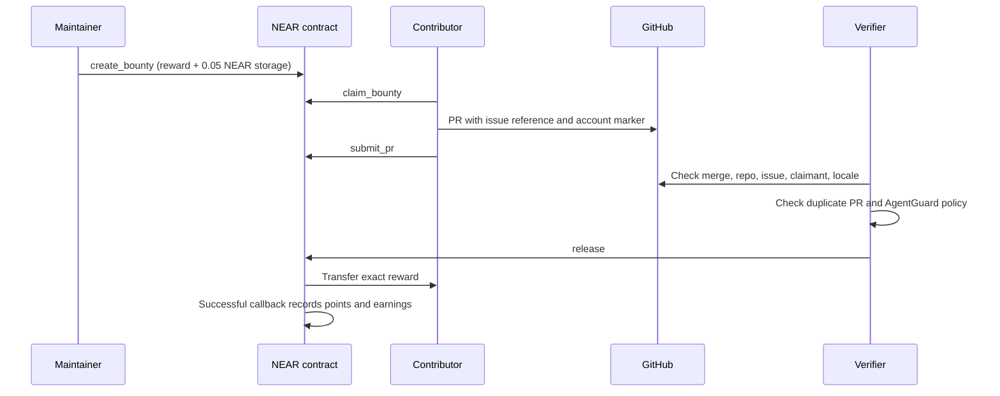

# GitSettle

Self-hosted GitHub contribution escrow on NEAR. Maintainers fund an issue; a contributor claims it and submits a PR; a verifier checks the merge and pays the contributor. Translation bounties also check that the PR changes the requested locale. Native NEAR escrow and reputation live on-chain.

Repository: **https://github.com/CodeMasterLabs/gitsettle**. Built for **NEAR HACKATHON**, November 2026. Tracks: **Social Money (`social`)**, **Open Innovation (`open`)**, and **Agent Economy (`agents`)** for the autonomous verification/payout worker. The payout worker uses deterministic rules with an AgentGuard risk gate; optional bring-your-own-LLM triage and chat provide advice without payment authority. No Sputnik DAO, Trezu, or NEAR Intents integration is claimed; an original NEAR contract is eligible under Q-011.

## Try it

**Live testnet app: https://gitsettle.89.167.109.196.sslip.io**. The contract address and reproducible transaction evidence are below.

Contributor quick starts: [English](locales/en/contributing.md) · [Español](locales/es/contributing.md).

```sh
git clone https://github.com/CodeMasterLabs/gitsettle.git
cd gitsettle
docker compose up --build
```

Open **http://localhost:3000**. With no environment file, this opens a clearly labeled demo queue. Filter Translation to see `es`, `bn`, and `ja` work; open a bounty to see its escrow lifecycle; browse contributor profiles and the leaderboard. Demo rewards are examples and signing is disabled. SQLite data persists in the `gitsettle-data` volume. Stop with `docker compose down`; do not add `-v` if you want to retain history.

To connect a real deployment, copy `.env.example` to `.env`, set `DEMO_MODE=false`, `NEAR_CONTRACT_ID`, `NEAR_VERIFIER_ACCOUNT_ID`, and `NEAR_VERIFIER_PRIVATE_KEY`, then restart Compose. Set `APP_ORIGIN` to the exact browser origin for support sign-in. The verifier key and optional GitHub token go only to the worker. The web receives public network settings and, if enabled, its own server-side LLM credential; no NEAR private key. `GITHUB_TOKEN` needs read access to the bounty repositories; unauthenticated public GitHub requests are subject to a low hourly rate limit.

Testnet deployment:

| Item | Value |
| --- | --- |
| Contract | `gitsettle-ac1b0f23f4.testnet` |
| Verifier | `verifier.gitsettle-ac1b0f23f4.testnet` |
| Network | NEAR Testnet |
| RPC | `https://test.rpc.fastnear.com` |
| Deployment transaction | [Cd741zywcPRe1npNGp4wgxTFbZhHKqncnfoBFww3LYRZ](https://testnet.nearblocks.io/txns/Cd741zywcPRe1npNGp4wgxTFbZhHKqncnfoBFww3LYRZ) |
| Artifact/config evidence | [docs/DEPLOYMENT.json](docs/DEPLOYMENT.json) |

The public address is usable for browsing; operating its verifier requires its private development credentials. Self-hosters should deploy their own contract and verifier. See [STATUS.md](STATUS.md) for completed checks and [docs/LIVE_E2E.json](docs/LIVE_E2E.json) for the real issue → merged translation PR → payout → reputation proof.

## What is included

- Rust escrow with exact native NEAR deposits, bounded storage, claim/submission deadlines, authorized release/refund, asynchronous transfer recovery, and a top-100 reputation view.
- Next.js App Router UI: dense work queue, type/status/reward filters, locale badges, bounty detail, wallet-funded posting, claim/submit, contributor profiles, leaderboard with observed rank movement, and maintainer dashboard.
- Wallet Selector v10 with real wallet signatures and transaction receipt validation. A wallet redirect alone never marks a payment confirmed.
- A Node verifier that checks PR merge, repository, exact issue reference, claimant binding and translation paths before signing `release`.
- Drizzle/SQLite metadata, verification audit and daily leaderboard snapshots; light/dark themes; responsive and keyboard-accessible states.
- Canonical issue/type/locale duplicate warnings before funding, duplicate-PR payout holds, and deterministic spam checks. Intentional duplicate funding remains possible with an explicit acknowledgment.
- [AgentGuard](docs/AGENTGUARD.md) recipient/text checks and a configurable 5 NEAR automatic-payout cap. Review holds protect submitted funds while the poster investigates.
- Wallet-authenticated private support tickets, appeal threads and conversation replies, with ACLs, replay protection and persistent spam limits.
- Optional operator-configured OpenAI-compatible LLM for advisory triage/review and AI help. No API key is required for escrow, deterministic checks or ordinary support.

## How escrow works



The **0.05 NEAR storage charge is permanent and nonrefundable**. It is shown separately from the reward before signing. A poster can refund the reward at or after the deadline only when the bounty is Open, Claimed, or Rejected. A timely Submitted PR stays protected after the deadline. Each successful authorized payout awards 100 points. Currency is integer yoctoNEAR throughout; one NEAR is 10²⁴ yoctoNEAR.

Every PR must include an exact closing reference, for example `Fixes #17`, and this standalone line using the actual IDs shown in the app:

```text
GitSettle: <contract-account>/<bounty-id>/<claimant-account>
```

For Translation, change a file such as `locales/es/messages.json`, `src/i18n/bn/common.json`, or `public/locales/ja/ui.json`. The locale must match exactly; `es` does not match `es-MX`. Removed-only files do not qualify. Merge after the bounty is funded. The worker checks all changed-file pages and leaves incomplete/API-error cases pending.

## Triage, appeals and support

Before funding, **Check issue** inspects issue identity, active duplicates and spam signals. AI review appears only when the operator configures a compatible provider and the user verifies their wallet. Automatic payment independently checks whether the PR has already been submitted/paid for another bounty; suspicious or oversized AgentGuard cases stay Submitted for review. These checks are application/worker safeguards, not contract-level uniqueness guarantees.

Open **Support**, connect a wallet and sign the domain-bound NEP-413 message to start a private ticket. This signature proves account ownership and spends no NEAR. A submitted/rejected bounty's claimant can open an appeal; the claimant, bounty poster and deployment support administrators can participate. Ordinary support is visible only to its creator and support administrators. Threads can be reviewed, replied to and resolved. **Appeals do not pause deadlines, prevent eligible refunds, or adjudicate escrow.** Messages are stored in the operator's database, not end-to-end encrypted. No response time is promised.

For optional AI, set `LLM_BASE_URL`, `LLM_API_KEY` and `LLM_MODEL` in the protected server environment. The endpoint must support OpenAI-compatible Chat Completions and strict JSON-schema output. Users explicitly request AI; selected questions/public issue context then go to that provider. Keys remain server-side. Each signed wallet has 20 AI attempts per UTC day. The hosted instance runs with AI disabled until a provider is configured; provider calls have been tested with controlled fixtures, not a live paid model.

See [docs/TRIAGE.md](docs/TRIAGE.md) and [docs/COMMUNITY.md](docs/COMMUNITY.md) for API, configuration, privacy, quotas and limits. [docs/COMMUNITY_E2E.json](docs/COMMUNITY_E2E.json) records the passing real-wallet HTTPS authentication, ticket privacy/reply/resolution and logout checks.

## Command line

The same core escrow workflow is available from a terminal. From a checkout with `npm ci` completed:

```sh
npm run cli -- list --type Translation --locale es --status Open
npm run cli -- show 8
npm run cli -- leaderboard --json
npm run cli -- claim 0 --dry-run
```

Use `npm link --workspace @gitsettle/cli` for a bare `gitsettle` command. Signed actions require `--yes` and a protected local wallet file or environment credential; ordinary reads and previews need no private key. The CLI talks directly to finalized testnet RPC, with an optional self-hosted API for read commands. Support conversations and AI remain in the web app. [docs/CLI.md](docs/CLI.md) documents every command and [docs/CLI_E2E.json](docs/CLI_E2E.json) records live read-only checks. This is an executable workspace package; no npm publication is claimed.

## Loading and data freshness

The board reads contract configuration and bounty pages in parallel, and a detail page loads only its bounty. Descriptive GitHub text refreshes in the background; it cannot block escrow data. Display reads use a five-second success-only cache, retain their actual read timestamp, and invalidate after confirmed wallet actions. Signing and confirmation always use the authoritative contract path. Errors never become fake balances.

The default documented testnet RPC is FASTNEAR. Browsing also defers the wallet signing bundle until Connect or an existing wallet return needs it. [docs/PERFORMANCE.md](docs/PERFORMANCE.md) records timings, measurement conditions and cache limits.

## Local development and checks

Use **Node 22.22.2 or later** (tested with 22.23.0), npm, and Rust via rustup. The Rust toolchain file pins 1.97.1 and the Wasm target. Current SDK/API versions were verified before implementation: [docs/API_SOURCES.md](docs/API_SOURCES.md).

```sh
npm ci
npm run dev
# In another terminal, when a real .env is configured:
npm run verifier
```

```sh
cargo test --manifest-path contracts/gitsettle/Cargo.toml --locked
cargo fmt --manifest-path contracts/gitsettle/Cargo.toml --check
cargo clippy --manifest-path contracts/gitsettle/Cargo.toml --all-targets --locked -- -D warnings
cargo build --manifest-path contracts/gitsettle/Cargo.toml --target wasm32-unknown-unknown --release --locked
npm run typecheck
npm test
npm run build
npx playwright install chromium
npm run test:ui
```

The contract unit suite covers state transitions and access-control paths, including transfer failure recovery and duplicate-payment prevention. Node tests cover adversarial GitHub evidence, locale pagination, oracle retries, exact currency, and wallet-return validation. Browser checks exercise all main screens and accessibility. [STATUS.md](STATUS.md) records which checks actually ran; CI runs the same layers plus Docker startup.

## Deploy and seed your own testnet instance

```sh
npm run wallets
# Build Wasm using the command above, then:
npm run deploy
cp .env.testnet .env
npm run seed -- --dry-run
npm run seed
npm run verifier -- --once --dry-run
docker compose up --build
```

`wallets` generates Ed25519 keys locally, saves them to ignored `.secrets/testnet-wallets.json` with mode 0600, creates a faucet-funded testnet contract account, and funds dedicated verifier/contributor subaccounts. Only a public key is sent to the faucet. `deploy` submits deployment and initialization atomically, records public evidence in `docs/DEPLOYMENT.json`, and writes ignored `.env.testnet`. It refuses to overwrite an account with deployed code. Back up development keys securely; neither Git nor Docker images contain them.

The seed script uses real issue URLs from `docs/SEED_ISSUES.json`; it never invents issues. It skips an existing matching seed from the poster on reruns and records public transaction hashes. Seed rewards are intentionally small testnet amounts. The separate local demo dataset uses larger illustrative amounts and never mixes them with live balances.

For a real end-to-end PR payout, use the two-phase live-loop script documented in [DEMO.md](DEMO.md). A local API fixture is not accepted as live payout evidence.

VPS instructions and credential boundaries: [docs/SELF_HOST.md](docs/SELF_HOST.md). Operational map, data flows, extension notes: [ARCHITECTURE.md](ARCHITECTURE.md). Contract methods: [docs/CONTRACT_API.md](docs/CONTRACT_API.md).

## Trust model and limitations

**The verifier is a trusted oracle.** NEAR cannot read GitHub. The configured verifier can approve or reject submitted work, and the poster can release directly without the worker's checks. A compromised verifier or poster can authorize an undeserved payout to the already-recorded claimant. They cannot use `release` to choose an arbitrary recipient. PR-body account markers reduce simple PR theft but are not cryptographic GitHub identity proofs; authorized GitHub users can edit them.

The contract deployment retains a full-access upgrade key. Its custodian can replace the code, so the fixed verifier field does not make the deployed system immutable. This is a testnet MVP, not an audited production custody system. Native unit tests do not establish every production Wasm gas bound; live receipt evidence is recorded separately.

The payout worker verifies evidence structure, not code quality, issue severity, review approval, or translation accuracy. Optional AI advice can be wrong and never changes that authorization policy. AgentGuard runs locally in the trusted worker and can be bypassed by a compromised signer or the poster’s manual release authority; no AgentGuard vault, TEE, or on-chain risk policy is claimed. A merge into a non-default branch can qualify; GitSettle checks the issue reference, not that GitHub actually closed the issue. `merged_count` counts authorized paid contributions, including poster overrides. Reputation can be farmed by colluding accounts and is not Sybil resistant.

One claimant can reserve a bounty until its deadline; there is no claim cancellation/lease. A submitted unmerged PR can protect funds indefinitely, and oracle disappearance can lock those funds. Rate limits, private/deleted repos and GitHub outages pause verification. GitHub's 3,000-file cap prevents automatic validation of larger translation PRs. The initial worker supports one process per deployment and no binding dispute adjudication; support appeals are off-chain conversations. SQLite is for one host; use a shared server database before scaling across hosts. Rank movement appears only after a real earlier-day snapshot exists.

Dependencies, residual advisory findings and implementation review are recorded in [docs/SECURITY_REVIEW.md](docs/SECURITY_REVIEW.md).

## Roadmap

- NEP-141 custom-token rewards with explicit token registration and storage handling.
- Binding dispute adjudication, submission expiry policy, independent reviewers, and enforceable appeal windows.
- Severity tiers, scoped acceptance criteria, and reviewer-attested quality.
- DAO approvals through Sputnik DAO/Trezu, including spending caps and multi-party release.
- Short claim leases, GitHub identity attestations, external indexer, and Postgres for multiple hosts.
- Translation preview checks, project-defined locale policies, semantic duplicate search, and quality benchmarks for optional AI advice.
- Support notifications, retention controls, pagination, and distributed abuse prevention.

## Hackathon provenance and submission

Development started from an empty workspace on November 14, 2026; no earlier application baseline was supplied. GitSettle's contract, verifier, UI, tooling and documentation were built in the hackathon window with AI coding assistance. Dependencies and templates: near-sdk, near-api-js, NEAR Wallet Selector, Next.js, React, Tailwind, Drizzle, better-sqlite3, Lucide, Source Sans 3, Manrope, Playwright, and the `frontend-design` skill. See lockfiles for exact packages. Reused AgentGuard code is described below. No pre-hackathon proprietary code is included. License: [MIT](LICENSE).

**Related project disclosure (Q-005/Q-015):** [AgentGuard](https://github.com/CodeMasterLabs/agentguard) is a separate project by the same developer. GitSettle vendors its MIT recipient/text risk rules at commit `4ec34e69bc7c6cfd17a3e027bf9727a67eab97f6` as reused baseline; these rules are not claimed as new GitSettle work. GitSettle provides contribution escrow, GitHub verification, its risk adapter, reputation, support and triage workflows; AgentGuard provides a separate vault/risk-oracle product. Exact files, license and hashes: [docs/AGENTGUARD.md](docs/AGENTGUARD.md). The user confirmed that AgentGuard is their other submitted hackathon project. Both projects disclose their relationship and distinct scope; the documentation-only reciprocal change is retained in [docs/agentguard-disclosure.patch](docs/agentguard-disclosure.patch).

The deadline is **2026-11-14 23:59 UTC**. A public repo and reproducible local demo are eligible; when judges cannot open the hosted demo, the X post must include a video. The human publishes the post and supplies team/contact details, mainnet prize account, and consent. The user will publish the X post and submit manually; the agent has been instructed not to send a hackathon application. [DEMO.md](DEMO.md) contains the demo script and X draft. Keep the repo public through judging and the hosted demo available through November 18, ideally November 25.
