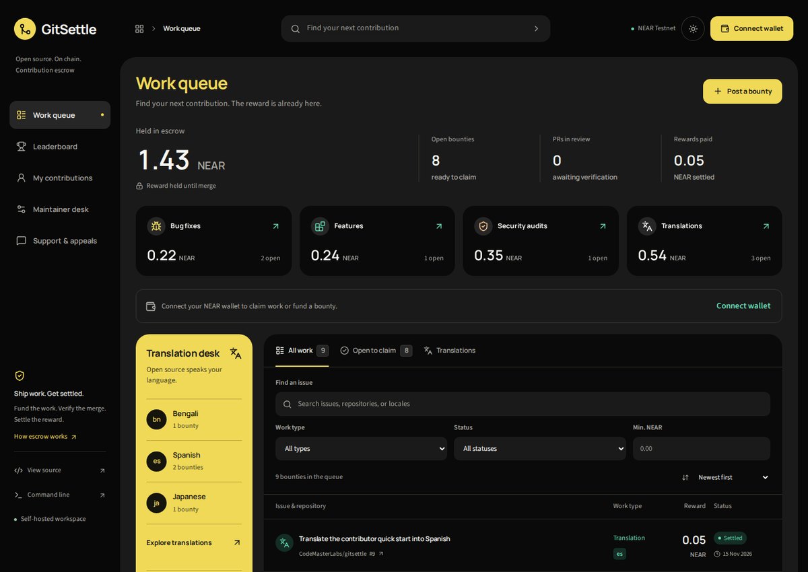
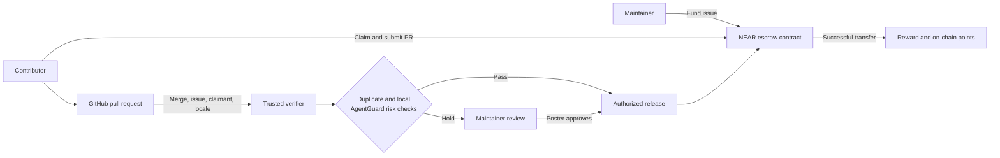
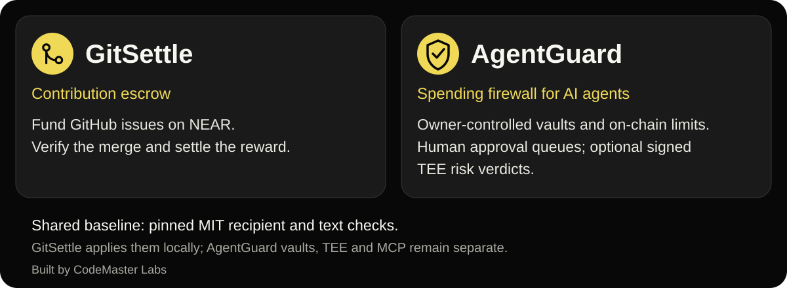

<p align="center">
  
</p>

<h1 align="center">GitSettle</h1>

<p align="center">
  <b>Fund the issue. Verify the merge. Settle the reward.</b><br />
  GitHub contribution escrow on NEAR, with a self-hosted web app, CLI and on-chain reputation.<br />
  Built by <a href="https://github.com/CodeMasterLabs">CodeMaster Labs</a> for NEAR HACKATHON · November 2026
</p>

<p align="center">
  <a href="https://github.com/CodeMasterLabs/gitsettle/actions/workflows/ci.yml"></a>
  <a href="https://testnet.nearblocks.io/address/gitsettle-ac1b0f23f4.testnet"></a>
  <a href="LICENSE"></a>
</p>

<p align="center">
  <a href="https://gitsettle.89.167.109.196.sslip.io"><b>Open the live app</b></a> ·
  <a href="#judge-walkthrough">Judge walkthrough</a> ·
  <a href="#quick-start">Quick start</a> ·
  <a href="#verification-and-evidence">Evidence</a> ·
  <a href="llms.txt">AI review index</a> ·
  <a href="#sister-project-agentguard">AgentGuard</a>
</p>

<p align="center">
  <a href="https://gitsettle.89.167.109.196.sslip.io"></a>
</p>

*The screenshot shows the real testnet deployment. The local Docker demo uses separately labeled example rewards.*

## In one minute

**The problem:** open-source maintainers need a clear way to fund useful work, and contributors need a visible reward and settlement process.

**The product:** a maintainer deposits native NEAR against a GitHub issue. A contributor claims the bounty and submits a pull request. A trusted verifier checks the actual merge, issue reference, claimant marker and requested locale before authorizing payout. The contract transfers the reward and records points only after a successful transfer.

**The proof:** [bounty 8](https://gitsettle.89.167.109.196.sslip.io/bounties/8) paid **0.05 NEAR** for [Spanish contributor documentation, PR #10](https://github.com/CodeMasterLabs/gitsettle/pull/10), adding **100 points** and one paid contribution. This completed testnet run is recorded in [LIVE_E2E.json](docs/LIVE_E2E.json), including the exact balance change and transaction hashes.

| Participant | What GitSettle provides |
| --- | --- |
| Maintainer | Fund bugs, features, audits and translations; review submissions; release or refund eligible rewards. |
| Contributor | Find scoped work, claim a bounty, submit a PR and build an on-chain contribution record. |
| Operator | Run the verifier and metadata service, configure risk checks, and self-host with Docker. |
| Reviewer | Inspect a completed payout, browse without a wallet, read the implementation and reproduce checks. |

**Current scope:** NEAR testnet, native NEAR rewards, a trusted GitHub verifier and an operator-controlled deployment. Optional AI provides advice; payment authority stays with the verifier and bounty poster.

## Judge walkthrough

**About four minutes, in a browser, with no installation or wallet.** The links below inspect an existing completed run.

| Step | Do | See |
| --- | --- | --- |
| 1 | Open the [live work queue](https://gitsettle.89.167.109.196.sslip.io/) and choose **Translations**. | Real contract-backed rewards and exact locale badges; category and status shortcuts filter the queue. |
| 2 | Open [paid bounty 8](https://gitsettle.89.167.109.196.sslip.io/bounties/8). | The Spanish task, **0.05 NEAR** reward, recorded claimant and settled state (`Released` on the contract). |
| 3 | Follow [issue #9](https://github.com/CodeMasterLabs/gitsettle/issues/9) and [merged PR #10](https://github.com/CodeMasterLabs/gitsettle/pull/10). | The actual issue reference, bounty/account marker and changed `locales/es/contributing.md` file. |
| 4 | Open the [release transaction](https://testnet.nearblocks.io/txns/Fe2qi4XGHsd5CvGZMdWq9Tr53MGg5WXyoce12ZnRyyCC) and [payout evidence](docs/LIVE_E2E.json). | Finalized transfer evidence and the exact **0.05 NEAR** contributor balance increase. |
| 5 | Open the [contributor profile](https://gitsettle.89.167.109.196.sslip.io/contributors/contributor.gitsettle-ac1b0f23f4.testnet) and [leaderboard](https://gitsettle.89.167.109.196.sslip.io/leaderboard). | **100 points**, **0.05 NEAR earned**, and one paid contribution from the recorded run. |
| 6 | Browse [posting](https://gitsettle.89.167.109.196.sslip.io/bounties/new) and [support](https://gitsettle.89.167.109.196.sslip.io/support), then inspect [CI](https://github.com/CodeMasterLabs/gitsettle/actions/runs/43619439586). | Escrow review and support entry points; mutation and private-session actions require a wallet. CI records the reproducible test/build/container layers. |

If the hosted app is unavailable, use the [local demo](#quick-start), [live screenshots](docs/UI_REVIEW.md#final-public-deployment-captures), and recorded chain/GitHub evidence. [DEMO.md](DEMO.md) includes the presentation script and instructions for reproducing a fresh payout.

**AI reviewers:** [llms.txt](llms.txt) is the concise product, source and evidence index. Public reads: [deployment configuration](https://gitsettle.89.167.109.196.sslip.io/api/config), [paid bounty JSON](https://gitsettle.89.167.109.196.sslip.io/api/bounties/8), and [leaderboard JSON](https://gitsettle.89.167.109.196.sslip.io/api/leaderboard). These require no credentials.

## Quick start

### Explore locally with Docker

Prerequisite: Docker Engine with Docker Compose. From a fresh checkout:

```sh
git clone https://github.com/CodeMasterLabs/gitsettle.git
cd gitsettle
docker compose up --build --detach --wait
```

Open **http://localhost:3000**. With no `.env`, the app displays **Demo data** and disables wallet transactions. Browse the queue, open a bounty, filter locales, and explore profiles and the maintainer dashboard. Local demo IDs are **0–7**; the recorded live payout is bounty **8** on the hosted deployment.

Stop with `docker compose down`. The `gitsettle-data` volume retains local history; `docker compose down -v` removes it.

### Read the live contract from a terminal

Prerequisite: Node **22.22.2+** and npm. From the same checkout:

```sh
npm ci
npm run cli -- show 8 --json
npm run cli -- profile contributor.gitsettle-ac1b0f23f4.testnet
npm run cli -- list --type Translation --locale es --status Open
npm run cli -- leaderboard --json
```

The CLI defaults to the documented testnet contract and reads finalized RPC state. These commands need no private key. Signed commands require `--yes` and protected local credentials. [CLI reference](docs/CLI.md) · [English contributor guide](locales/en/contributing.md) · [Guía en español](locales/es/contributing.md).

## Use GitSettle

| Workflow | What to do | Important behavior |
| --- | --- | --- |
| Fund work | Connect a testnet wallet, choose **Post a bounty**, enter the GitHub issue, type, locale when applicable, reward and deadline; review and sign. | The reward and permanent **0.05 NEAR storage charge** are shown separately. Duplicate funding requires acknowledgment. |
| Contribute | Open an available bounty, claim it, make the change, and submit the PR URL. | Include the exact issue reference and claimant marker below. The recorded claimant receives the reward. |
| Settle or review | The verifier checks merged work; maintainers inspect held submissions in the dashboard. | Risk/duplicate holds keep work Submitted. The poster can also approve a submitted reward directly. |
| Ask for help | Connect a compatible wallet and sign the NEP-413 ownership message in **Support**. | This spends no NEAR. Tickets are private to their authorized participants and stored by the operator. Appeals are conversations, not binding adjudication. |

A qualifying PR includes an exact closing reference such as `Fixes #17`, plus this standalone line using the IDs shown in the bounty:

```text
GitSettle: <contract-account>/<bounty-id>/<claimant-account>
```

Merge **after the bounty is funded**. For translations, change an eligible file under the exact requested locale, for example `locales/es/messages.json` or `src/i18n/bn/common.json`. `es` and `es-MX` are different locales; removed-only files do not qualify. The verifier validates evidence structure, not code or translation quality. [Verifier rules](services/verifier/README.md).

**Wallets:** MyNearWallet, Meteor, Intear and Nightly are offered through the custom picker. Intear supports escrow actions but its current adapter cannot authenticate private support. Provider and browser verification limits are documented in [WALLETS.md](docs/WALLETS.md).

**Triage and AI:** deterministic issue/duplicate/spam checks and wallet-authenticated support work without an LLM key. An operator may enable an OpenAI-compatible provider for advisory triage and help; the hosted instance currently has **AI disabled**. Provider tests use controlled fixtures. [Triage](docs/TRIAGE.md) · [Support, privacy and quotas](docs/COMMUNITY.md).

## How it works



| Component | Responsibility | Source |
| --- | --- | --- |
| NEAR contract | Escrow, claim/submission state, authorized release/refund, transfer recovery and top-100 reputation. | [contracts/gitsettle](contracts/gitsettle) · [Contract API](docs/CONTRACT_API.md) |
| Verifier | Paginated GitHub evidence checks, duplicate-PR checks and local AgentGuard policy before signing. | [services/verifier](services/verifier) |
| Web app | Queue, posting, wallet actions, contributor pages, maintainer desk and private support. | [apps/web](apps/web) |
| CLI | Finalized reads and explicit transaction previews/signing. | [apps/cli](apps/cli) |
| SQLite + shared packages | Metadata, audit, support and real daily rank snapshots; exact money/contract types. | [packages](packages) |

NEAR is authoritative for funds and reputation; SQLite stores off-chain metadata and conversations. Amounts use integer yoctoNEAR. Display reads have a short success-only cache; signing and confirmation use authoritative contract evidence. [Architecture](ARCHITECTURE.md) · [Performance and cache limits](docs/PERFORMANCE.md).

## Verification and evidence

**Verified November 14, 2026.** [CI run 43619439586](https://github.com/CodeMasterLabs/gitsettle/actions/runs/43619439586) passed on deployed application source `5c8dc527b3d6d29f6773ff6ac402c5886083f512`.

| Claim | Evidence | What it establishes |
| --- | --- | --- |
| Real GitHub → NEAR settlement | [LIVE_E2E.json](docs/LIVE_E2E.json), [issue #9](https://github.com/CodeMasterLabs/gitsettle/issues/9), [PR #10](https://github.com/CodeMasterLabs/gitsettle/pull/10), [release receipt](https://testnet.nearblocks.io/txns/Fe2qi4XGHsd5CvGZMdWq9Tr53MGg5WXyoce12ZnRyyCC) | Automatic verifier release, exact balance increase, points and leaderboard updates. |
| Contract behavior | [41 Rust tests in CI](https://github.com/CodeMasterLabs/gitsettle/actions/runs/43619439586), [contract tests](contracts/gitsettle/src/lib.rs) | State/access-control checks and transfer recovery; separate live evidence covers the deployed flow. |
| Application and adversarial checks | [182 Node tests in CI](https://github.com/CodeMasterLabs/gitsettle/actions/runs/43619439586) | Exact currency, GitHub policy, wallet-return races, support access controls and CLI fixtures. |
| Browser layouts and accessibility | [146 passed, 1 skipped](https://github.com/CodeMasterLabs/gitsettle/actions/runs/43619439586), [UI review](docs/UI_REVIEW.md) | Main screens and relevant WCAG checks; actual light/dark toggles checked at nine additional sizes. |
| Real support authentication | [COMMUNITY_E2E.json](docs/COMMUNITY_E2E.json) | Finalized-key NEP-413 signatures, replay/CSRF checks, ticket isolation, replies, resolution and logout. |
| CLI reads and Docker startup | [CLI_E2E.json](docs/CLI_E2E.json), [Docker verification](docs/DOCKER_VERIFICATION.md), [CI](https://github.com/CodeMasterLabs/gitsettle/actions/runs/43619439586) | Read-only CLI against testnet and clean-checkout container startup. |

[STATUS.md](STATUS.md) records runtime revisions and verification history. Local demo data, browser response fixtures and AI/provider fixtures are labeled; they are not evidence of real wallet approvals, paid AI calls or payouts.

| Live deployment | Value |
| --- | --- |
| App | https://gitsettle.89.167.109.196.sslip.io |
| Contract | [`gitsettle-ac1b0f23f4.testnet`](https://testnet.nearblocks.io/address/gitsettle-ac1b0f23f4.testnet) |
| Verifier account | `verifier.gitsettle-ac1b0f23f4.testnet` |
| Network / RPC | NEAR Testnet / `https://test.rpc.fastnear.com` |
| Deployment evidence | [DEPLOYMENT.json](docs/DEPLOYMENT.json) |

## Sister project: AgentGuard

**[AgentGuard](https://github.com/CodeMasterLabs/agentguard) is another NEAR hackathon project built by CodeMaster Labs.** It gives AI agents owner-controlled spending vaults: on-chain limits, human approval queues, restricted agent keys and optional signed risk verdicts from a TEE oracle.

[Explore AgentGuard](https://agentguard-beryl.vercel.app) · [No-wallet demo vault](https://agentguard-beryl.vercel.app/?contract=guard.cm-agentguard.testnet&network=testnet&vault=6#/app) · [Watch its 1:56 demo](https://agentguard-beryl.vercel.app/agentguard-demo.mp4) · [Source and judging guide](https://github.com/CodeMasterLabs/agentguard#judge-walkthrough-do-x-see-y)

<p align="center">
  <a href="https://github.com/CodeMasterLabs/agentguard"></a>
</p>

| GitSettle | AgentGuard |
| --- | --- |
| Contribution escrow tied to GitHub issues and PRs. | Policy-controlled spending vaults for AI agents. |
| Merge/locale verification, contributor reputation, support and triage. | Spending limits, approval queues, risk-oracle verdicts and MCP tools. |
| Local recipient/text-risk checks in a trusted payout worker. | A separate contract and oracle product with its own evidence and trust model. |

**Shared baseline disclosure:** GitSettle vendors AgentGuard's MIT recipient/text heuristics at commit `4ec34e69bc7c6cfd17a3e027bf9727a67eab97f6`; those rules are reused work. GitSettle's adapter adds an exact per-payout cap (default **5 NEAR**) and review holds. GitSettle does not use AgentGuard's vault custody, TEE execution, signed oracle verdicts, MCP server or cross-chain settlement. [Integration, files, license and hashes](docs/AGENTGUARD.md) · [Reciprocal disclosure](https://github.com/CodeMasterLabs/agentguard#related-project-disclosure).

## Self-hosting

For a real testnet instance, deploy **your own contract and verifier**. Copy `.env.example` to `.env`, set `DEMO_MODE=false` and the actual contract/verifier configuration, and set `APP_ORIGIN` to the exact browser origin. Keep operator credentials in protected runtime configuration. The Compose web service receives no NEAR signing key or GitHub token; the verifier receives only the credentials it needs.

[Self-host and VPS guide](docs/SELF_HOST.md) · [Hosting details](docs/HOSTING.md) · [Deployment and seed workflow](DEMO.md#reproduce-the-actual-github-to-near-loop) · [Environment template](.env.example).

<details>
<summary>Deploy a fresh testnet contract and verifier</summary>

After `npm ci`, use the repository's testnet setup scripts:

```sh
npm run wallets
cargo build --manifest-path contracts/gitsettle/Cargo.toml --target wasm32-unknown-unknown --release --locked
npm run deploy
cp .env.testnet .env
npm run seed -- --dry-run
npm run seed
npm run verifier -- --once --dry-run
docker compose up --build --detach --wait
```

These steps create and fund testnet accounts, deploy/initialize the contract and seed small real testnet rewards. Generated private keys stay in ignored `.secrets/` and `.env.testnet`; back them up securely. Seeding uses the real issue URLs in [SEED_ISSUES.json](docs/SEED_ISSUES.json) and skips matching existing seeds. Review the dry-run output before funding. [Deployment evidence format](docs/DEPLOYMENT.json) · [Fresh PR-to-payout reproduction](DEMO.md#reproduce-the-actual-github-to-near-loop).

</details>

### Develop and run checks

Node **22.22.2+** (tested with 22.23.0), npm and Rust/rustup. The repository pins Rust **1.97.1** and the Wasm target.

```sh
npm ci
npm run dev
# With a real testnet environment, run the worker separately:
npm run verifier
```

```sh
npm run typecheck
npm test
npm run build
npx playwright install chromium
npm run test:ui
cargo test --manifest-path contracts/gitsettle/Cargo.toml --locked
```

CI also runs Rust formatting, Clippy, the locked release Wasm build and clean Docker startup. [API/version sources](docs/API_SOURCES.md) · [Verifier development](services/verifier/README.md).

## Trust model and limitations

- **Trusted verifier and poster authority:** NEAR cannot read GitHub. The configured verifier is an oracle, and the bounty poster can release directly, bypassing worker checks. Release pays the recorded claimant; it cannot select an arbitrary recipient. PR markers are not cryptographic GitHub identity proofs.
- **Upgradeable testnet MVP:** the deployed contract retains a full-access upgrade key. This is operator-controlled, has not received an independent security audit, and is not immutable production custody.
- **Permanent storage and protected submissions:** the **0.05 NEAR storage charge is nonrefundable**. At/after the deadline, Open, Claimed and Rejected rewards can be refunded. A timely Submitted PR remains protected, potentially indefinitely if it never merges or the oracle disappears. A claimant can reserve work until the deadline; there is no claim lease/cancellation.
- **Evidence, not quality adjudication:** the worker checks merge/repository/issue/claimant/locale evidence, not code quality, severity or translation accuracy. Non-default-branch merges can qualify; an issue reference does not prove GitHub closed the issue. Reputation counts authorized payouts, including manual overrides, and is not Sybil resistant.
- **Local risk checks and advisory AI:** a compromised signer or the poster can bypass AgentGuard's worker checks. Heuristics can miss attacks or flag legitimate text. Optional AI can be wrong and cannot authorize escrow. Appeals do not pause deadlines, block eligible refunds or reverse payments.
- **Operational limits:** GitHub/RPC outages and rate limits delay verification; the GitHub 3,000-file cap prevents automatic validation of larger translation PRs. One verifier process and SQLite on one host are the initial operating model. Private support is operator-readable, not end-to-end encrypted. Rank movement requires a real earlier-day snapshot.

[Security review and dependency findings](docs/SECURITY_REVIEW.md) · [Contract behavior](docs/CONTRACT.md) · [AgentGuard limitations](docs/AGENTGUARD.md#trust-and-false-positives).

## Hackathon provenance and submission

GitSettle was built from an empty workspace on **November 14, 2026**, during the hackathon window, with AI coding assistance. Track fit:

| Track | Implemented contribution |
| --- | --- |
| **Social Money (`social`)** | Issue-based rewards, translation discovery, contribution reputation and wallet-authenticated community support. |
| **Open Innovation (`open`)** | An original NEAR escrow contract with a reproducible web/CLI/self-hosting stack. |
| **Agent Economy (`agents`)** | A deterministic verification/payout worker with risk holds. Optional LLM triage is advisory. |

No Sputnik DAO, Trezu or NEAR Intents integration is claimed. AgentGuard is the same developer's other hackathon project, with distinct scope and the reused baseline disclosed above. Submission and the demo post are handled manually by the project owner. [Presentation script and human handoff](DEMO.md).

**Roadmap:** token rewards, submission-expiry/dispute policy, independent reviewer attestations, claim leases, GitHub identity attestations, DAO approvals and a shared database for multiple hosts. These are future work.

**License and attribution:** GitSettle application code is [MIT](LICENSE). Dependencies include near-sdk, near-api-js, NEAR Wallet Selector, NEAR Connect, Next.js, React, Tailwind, Drizzle, better-sqlite3, Lucide, Manrope, Source Sans 3 and Playwright; lockfiles pin packages. The visual design follows the supplied dashboard reference with the `frontend-design` skill; the reference image is not redistributed. AgentGuard's reused rules retain their MIT license. The separate Intear executor retains upstream AGPL/MIT licenses and corresponding source in [third_party/intear](third_party/intear/README.md); external Meteor executor provenance is in [WALLETS.md](docs/WALLETS.md). Third-party executors are dependencies, not newly written GitSettle work.
