# Contract engineering notes

The Rust contract owns reward custody and the reputation ledger. Its immutable
verifier account is a trusted GitHub oracle. The poster also has explicit power
to release a submitted bounty, without an oracle decision. This is not a
trustless merge proof, a decentralized dispute system, or a code-quality audit.

## State machine

```mermaid
stateDiagram-v2
  [*] --> Open: poster deposits reward + storage
  Open --> Claimed: contributor claims before deadline
  Claimed --> Submitted: claimant submits before deadline
  Submitted --> Rejected: verifier rejects invalid evidence
  Rejected --> Submitted: claimant corrects before deadline
  Submitted --> Releasing: verifier or poster releases
  Releasing --> Released: transfer succeeds; award reputation
  Releasing --> Submitted: transfer fails
  Open --> Refunding: poster; deadline reached
  Claimed --> Refunding: poster; deadline reached
  Rejected --> Refunding: poster; deadline reached
  Refunding --> Refunded: transfer succeeds
  Refunding --> Open: failed transfer; previously Open
  Refunding --> Claimed: failed transfer; previously Claimed
  Refunding --> Rejected: failed transfer; previously Rejected
```



Claim and submission are disabled at the deadline; refunds are enabled at it.
A timely Submitted bounty cannot be refunded merely because the worker is slow.
The oracle can release or reject after the deadline. A not-yet-merged PR, network
error or rate limit is not proof of invalidity. Those remain pending; a definitive
invalidity decision may be rejected and corrected before deadline or refunded
afterwards. This conservative design can lock funds if the oracle disappears.
The poster can pay a Submitted bounty, but cannot unilaterally invalidate it.

## Fund and storage accounting

`create_bounty` accepts exactly `reward + 0.05 NEAR`. The reward is positive and
bounded at 1,000,000 NEAR. The 0.05 NEAR reserve is nonrefundable and remains in
the contract to fund permanent storage. All other methods reject attached funds.
No administrative withdrawal function exists. Initial contract code/state storage
must also be funded in the deployment account.

All stored strings are bounded. A maximum-payload unit test flushes the SDK's
write caches and measures the entire bounty lifecycle, including rejection,
contributor creation and leaderboard insertion. This guards the permanent-storage
charge against spending existing escrows to subsidize new entries. Keep this test
when changing fields, indices or storage collections. Adding unbounded strings or
additional growth requires a new reserve calculation before deployment.

The transfer amount is always exactly the reward. Before the transfer, the
contract enters Releasing or Refunding. A second settlement is rejected while
that receipt is pending. A private callback with exactly one transfer result
marks completion or restores the prior state on failure. Only successful reward
callbacks increment points, merged count and earned amount. Transfer failures
do not earn reputation. Saturating arithmetic keeps successful transfers
finalizable even at counter limits.

The 30 Tgas callback is reserved before scheduling a transfer. A unit test also
exercises a callback with a full top-100 leaderboard under the mocked host gas
budget. Native unit tests do not meter WASM instructions, so real receipt
execution remains an integration check rather than a claim based on this test.
Runtime failures such as a contract upgrade incompatible with its storage, a
protocol change, or exhausted storage can still require operator intervention;
there is no safe generic timeout retry after an unknown transfer outcome.

## Bounded queries

Bounties use `near_sdk::store::LookupMap`. Contributor statistics use an
`IterableMap`. Individual reads touch only their record. List calls fetch at most
100 IDs. A materialized top-100 leaderboard avoids an unbounded account scan
during a view. Its tie break is account ID, its points increment is 100 per
successful settlement, and each account's complete profile is separately
available. Reputation is susceptible to collusion and Sybil activity; the MVP
does not pretend these points are an identity or quality guarantee.

## Build and test

From the repository root:

```sh
cargo test --manifest-path contracts/gitsettle/Cargo.toml --locked
cargo fmt --manifest-path contracts/gitsettle/Cargo.toml --check
cargo clippy --manifest-path contracts/gitsettle/Cargo.toml --all-targets --locked -- -D warnings
cargo build --manifest-path contracts/gitsettle/Cargo.toml --target wasm32-unknown-unknown --release --locked
```

`rust-toolchain.toml` pins Rust 1.97.1 with the wasm target. `Cargo.toml` pins
near-sdk 5.30.2; the lockfile fixes transitive versions. Artifact:
`contracts/gitsettle/target/wasm32-unknown-unknown/release/gitsettle.wasm`.
Unit tests mock NEAR receipts; public testnet deployment and real receipt
execution are separate integration checkpoints recorded in `STATUS.md`.

Verified contract checkpoint: 41 unit tests pass; formatting and Clippy with
warnings denied pass; the release WASM builds. The maximum bounded record
lifecycle measures 1,175 storage bytes, below the reserve's 5,000-byte capacity
at the tested storage-byte price. Initial artifact size: 418,067 bytes; SHA-256:
`88a9d6824ff7b09f107bf7682dea477bd1352dbdb11ab5520abd8cae56170137`.

## Sources verified before implementation

Read on November 14, 2026:

- [near-sdk 5.30.2 API](https://docs.rs/near-sdk/5.30.2/near_sdk/): `#[near]`,
  payable/private methods, `NearToken`, `Gas`, promises, unit-testing feature.
- [SDK manifest](https://github.com/near/near-sdk-rs/blob/master/near-sdk/Cargo.toml)
  and [workspace manifest](https://github.com/near/near-sdk-rs/blob/master/Cargo.toml):
  current version 5.30.2, Rust minimum 1.95, minimum protocol 85.
- [Persistent collection guidance](https://github.com/near/near-sdk-rs/blob/master/near-sdk/src/store/mod.rs):
  lazy caching and explicit `flush()` before measuring storage.
- [Promise result API](https://github.com/near/near-sdk-rs/blob/master/near-sdk/src/environment/env.rs):
  bounded `promise_result_checked` instead of deprecated unbounded reads.
- [Mock receipt definitions](https://github.com/near/near-sdk-rs/blob/master/near-sdk/src/environment/mock/receipt.rs)
  and [test context](https://github.com/near/near-sdk-rs/blob/master/near-sdk/src/test_utils/context.rs).
- [Testnet RPC status](https://rpc.testnet.near.org/status): protocol 88 was
  reported at verification, above the SDK's protocol 85 minimum.

The latest docs contain an older `5.17.0` quick-start snippet; the pinned version
comes from the resolved 5.30.2 API and manifest rather than copying that snippet.
